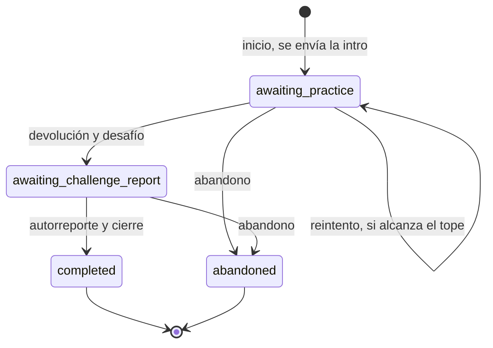

# ADR 0007: motor de lecciones y rachas

**Estado:** aceptado, 30/10/2026.

## Contexto

Una lección recorre intro, práctica, desafío y cierre, con un máximo de 5 mensajes pagos. Tiene que funcionar igual por WhatsApp, por el simulador y en los tests, y poder probarse sin esperar días reales.

## Decisión

**El motor es una máquina de estados de funciones puras.** Recibe el estado actual y un evento, y devuelve el estado nuevo y los mensajes para enviar. No toca la base de datos, ni el reloj, ni WhatsApp. La fecha entra como parámetro, y por eso los tests pueden simular el tiempo.

**Presupuesto de mensajes:**

| Inicio              | Práctica      | Mensajes pagos                                      |
| ------------------- | ------------- | --------------------------------------------------- |
| Escribió el usuario | Sin reintento | 4: intro, devolución, desafío, cierre               |
| Escribió el usuario | Un reintento  | 5: suma una devolución                              |
| Recordatorio        | Sin reintento | 5: recordatorio, intro, devolución, desafío, cierre |

Con recordatorio no hay presupuesto para reintentar. El motor lanza un error si un camino superara el tope, y la base de datos también lo rechaza.

**Racha sin castigo:**

- Cuenta lecciones programadas: de lunes a viernes, sin feriados.
- Una lección por día de lección. El fin de semana se puede recuperar la del viernes.
- Si falta a una lección programada, la racha vuelve a empezar. La mejor racha y el progreso se conservan, y el mensaje nunca reta.

**Contenido:**

- Las claves del YAML están en español, porque las edita el rol de contenidos. El código las traduce al dominio en inglés.
- El guion tiene un máximo de 650 caracteres, unos 40 segundos de audio. Los borradores tienen unos 350 caracteres: estimamos unos 25 segundos, a medir en la Fase 3.
- Todo desafío tiene un recordatorio de seguridad obligatorio.
- Cada intento guarda la versión de la lección que usó.

**Teléfonos:** se guardan cifrados con AES-256-GCM. Para buscarlos se usa un HMAC con clave aparte: un hash común se podría revertir probando todos los teléfonos posibles.

**Orden de las lecciones:** "Dónde está la IA" pasó a ser la lección 2, para que el desafío no llegue antes de saber dónde encontrarla. "Charlá nunca te pide datos" es la lección 3, y no la 9, para que la regla llegue pronto.

## Alternativas

- **Una librería de máquinas de estados, como XState:** demasiado para 4 estados, y otra cosa más que aprender.
- **Lógica mezclada con el acceso a datos:** más directa al principio, pero obliga a usar la base hasta para probar una regla.

## Consecuencias

- Tests muy rápidos, sin base de datos, sobre las 10 lecciones reales.
- El resultado del desafío se clasifica con reglas simples. Ante la duda, cuenta como hecho, para no desanimar. Se revisa si aparecen errores en el uso real.
- **Pendiente para la Fase 4:** borrar un usuario también borra sus consentimientos. Hay que decidir si conviene conservar una constancia mínima de que hubo consentimiento y baja, y consultarlo en la revisión legal.
- **Pendiente para la Fase 5:** cuándo se marca un intento como abandonado.
- **Pendiente para la Fase 3:** cuándo una respuesta va en audio. Hoy solo la intro está marcada como audio.
