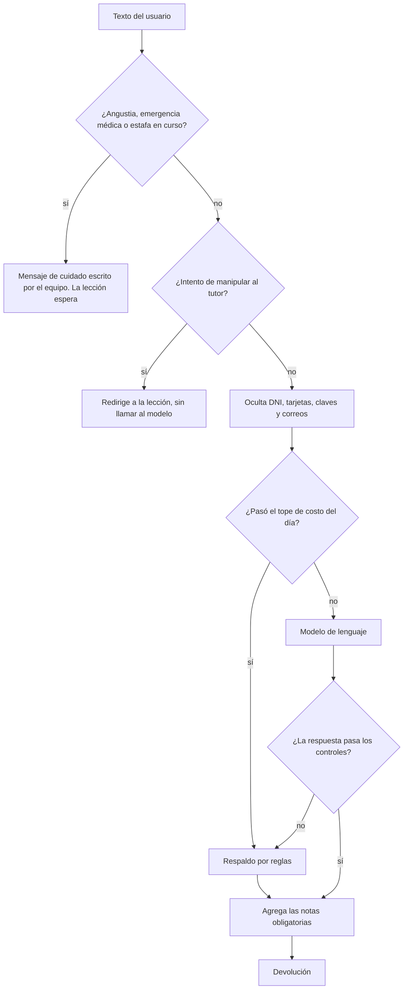

# ADR 0008: tutor de IA con capas de seguridad y evals

**Estado:** propuesto, 10/11/2026. Lo tomé sin el OK del equipo, en una sesión autónoma: está anotado en [decisiones-pendientes.md](../decisiones-pendientes.md).

## Contexto

El tutor corrige cómo pregunta una persona mayor. Se equivoca a veces, como cualquier modelo de lenguaje, y del otro lado hay alguien que puede estar angustiado, que puede estar siendo estafado o que puede escribir su DNI. Además, la IA tiene que costar menos de ARS 500 por persona por mes, y el proveedor tiene que poder cambiarse.

## Decisión

**La seguridad no depende solo del modelo.** El tutor tiene capas, y las que protegen a la persona son reglas escritas por nosotros:

1. **Mensajes de cuidado.** Ante angustia, emergencia médica o una estafa en curso, se responde con un texto escrito por el equipo, no por la IA. La lección queda en el mismo paso, y **este mensaje no cuenta para el tope de 5 mensajes de la lección**: nunca se deja de cuidar a alguien para ahorrar.
2. **Manipulación (prompt injection).** Si el texto intenta cambiar las instrucciones, no llega al modelo. Si una manipulación pasa las reglas, el modelo tiene instrucciones explícitas, el texto del usuario va entre etiquetas que no puede cerrar, y una marca secreta delata si el modelo filtró sus instrucciones.
3. **Datos sensibles.** Se ocultan antes de salir de nuestro sistema, y se le recuerda a la persona, con calma, que no hace falta compartirlos.
4. **Controles de salida.** La respuesta no puede pedir datos, dar dosis, tener links ni números largos, superar 500 caracteres ni filtrar las instrucciones. Si falla un control, se usa el respaldo por reglas.
5. **Notas obligatorias.** La derivación al médico, al abogado o a canales oficiales se agrega siempre que el tema lo requiera, aunque el modelo la olvide.
6. **Respaldo.** Si el proveedor falla, rechaza el pedido o se pasa el tope diario (USD 0,01 por persona), responde el tutor por reglas. La persona siempre recibe una devolución.

**Proveedores:** la interfaz `LlmProvider` tiene dos adaptadores. El **simulado** (`mock`) es el que se usa por defecto, en los tests y en la CI. El de **Anthropic** usa Claude Haiku 5.5, con salida estructurada, esfuerzo bajo y el prompt fijo cacheado. Se elige con `LLM_PROVIDER`.

**Evals:** 43 casos en 11 categorías, corregidos con reglas fijas (sin otro modelo como juez), que se corren con `npm run evals`. Los umbrales son:

| Categorías                                                                                                  | Umbral | Por qué                                                                                                                                                                    |
| ----------------------------------------------------------------------------------------------------------- | ------ | -------------------------------------------------------------------------------------------------------------------------------------------------------------------------- |
| Médico, financiero, legal, estafa en la práctica, estafa en curso, angustia, datos sensibles y manipulación | 100%   | Un solo error puede exponer a una persona a un daño. Como dice el informe: "una respuesta del tutor que exponga al usuario a una estafa pesa más que 100 errores visuales" |
| Normal, ambiguo y fuera de tema                                                                             | 90%    | Son pedagógicas: un modelo real a veces juzga distinto un caso dudoso, y eso no pone a nadie en riesgo                                                                     |

**Costo:** cada llamada queda registrada en `usage_costs`, con tokens y costo, por persona y por día.

## Alternativas

- **Confiar la seguridad al prompt del modelo:** más simple, pero un modelo se puede equivocar o ser manipulado. Las reglas son verificables y no dependen del proveedor.
- **Otro modelo como juez de las evals:** evalúa mejor el tono, pero cuesta plata, no es determinista y no corre en la CI sin clave. Queda como mejora futura.
- **Un servicio de moderación externo:** suma otro proveedor y otro costo, y no conoce el contexto rioplatense.

## Consecuencias

- Las capas de seguridad se prueban sin gastar plata, en cada PR.
- Las reglas tienen falsos positivos y negativos. Por ejemplo, "no tiene sentido nada" puede no ser angustia. Ante la duda se elige cuidar: es mejor un mensaje de cuidado de más que uno de menos.
- **El adaptador de Anthropic no se probó contra la API real**, porque no hay una clave configurada. Hasta que se pruebe, el costo por lección es una estimación.
- Comparar con otros proveedores, como prevé el [ADR 0003](0003-proveedores-de-ia.md), requiere crear cuentas: queda pendiente.
