# ADR 0010: adaptador de WhatsApp, alta con consentimiento, BAJA y AYUDA

**Estado:** propuesto, 10/11/2026. Lo tomé en una sesión autónoma, salvo la regla de consentimiento primero, que aprobó el equipo (decisión 26). Las demás decisiones están en [decisiones-pendientes.md](../decisiones-pendientes.md), de la 34 en adelante.

## Contexto

Charlá vive en WhatsApp. Meta manda cada mensaje a un webhook firmado, puede reintentar o duplicar envíos durante días, y cada respuesta se paga. Además:

- nadie puede quedar registrado sin un consentimiento explícito;
- `BAJA` borra todos los datos;
- `AYUDA` tiene que llegar a una persona, como exige la política de WhatsApp.

## Decisión

### Identidad por contacto

Meta recomienda identificar a las personas por su id por empresa (BSUID, `from_user_id`): siempre viene, y el teléfono puede faltar si la persona usa nombre de usuario. Un contacto es `wa:<BSUID>` o `tel:<teléfono>`, cifrado y con hash. Se responde con `recipient` (BSUID) o `to` (teléfono), según la [guía de envío](https://developers.facebook.com/documentation/business-messaging/whatsapp/messages/send-messages.md).

### Orden de un mensaje (`MessageRouter`)

```mermaid
flowchart TD
  M[Mensaje] --> K{¿BAJA o AYUDA?}
  K -- BAJA --> B[Borra todo y se despide]
  K -- AYUDA --> A[Abre un pedido para el equipo]
  K -- no --> U{¿Ya aceptó?}
  U -- no --> O[Alta: pide consentimiento]
  U -- sí --> L[Lección, como en el simulador]
  L --> C{¿Hubo mensaje de cuidado?}
  C -- sí --> A2[También abre un pedido para el equipo]
```

### Alta con consentimiento primero

- El primer mensaje recibe el pedido de consentimiento (`content/consentimiento.yaml`, versionado y en borrador).
- Hasta el `ACEPTO`, solo existe una fila en `pending_signups`, con el hash del contacto, la fecha y la cantidad de pedidos.
- Con `NO`, o después de 3 pedidos sin respuesta, se borra.
- **Antes de aceptar, un audio no se transcribe:** mandarlo a un tercero ya sería tratar datos de la persona.
- Al aceptar, se crea la persona y se registran dos consentimientos con la versión del texto.

### BAJA y AYUDA

- Cuentan solo si el mensaje es exactamente la palabra, para no confundirse con una práctica como "necesito ayuda con la receta".
- **BAJA** borra a la persona, su avance, sus pedidos de ayuda y, después de mandar la despedida, sus mensajes en tránsito.
- **AYUDA** abre un pedido en `support_requests`, que se atiende con `npm run support`. La respuesta sale desde el número de Charlá. Un mensaje de cuidado también abre un pedido, marcado como prioridad.

### Webhook confiable

1. **Verificación:** la verificación (`GET`) compara el token en tiempo constante.
2. **Firma:** cada `POST` se valida con HMAC-SHA256 del cuerpo exacto y el secreto de la app.
3. **Sin duplicados:** cada mensaje se guarda una sola vez, por su id de Meta, cifrado, y se encola en pg-boss. El webhook contesta 200 enseguida.
4. **Procesamiento en un solo paso:** el trabajo pasa el mensaje por el ruteador. Después, en una transacción, guarda las respuestas cifradas y borra el contenido del mensaje.
5. **Envío y reintento:** se mandan las respuestas pendientes. Si un envío falla, el reintento manda solo las que faltan, sin volver a correr la lección.
6. **Limpieza:** al terminar se borra el contacto. Con BAJA, se borran los registros de esa persona.
7. **Límite:** 20 mensajes por minuto por persona. Lo que pasa el límite no se responde.

**Notas de voz:** se descargan en dos pasos (id → URL, que vence a los 5 minutos), se transcriben y se descartan. Las respuestas en audio se suben y se mandan con `voice: true`, que requiere OGG/Opus.

**Plantillas:** viven en `content/plantillas-whatsapp.yaml` y se validan con las reglas de Meta. Se usan desde la Fase 5.

## Alternativas

- **Identificar por teléfono:** era lo más simple, pero el teléfono puede no venir.
- **Procesar dentro del webhook:** sin cola, una falla perdía el mensaje y Meta reintentaba durante días.
- **Pedir confirmación antes de la BAJA:** más seguro ante un error, pero el pedido fue que BAJA borre. Una persona que se arrepiente puede volver a escribir.

## Consecuencias

- Todo el flujo se prueba sin un número real: con el adaptador falso (`WHATSAPP_PROVIDER=fake`) y con webhooks firmados que imitan la documentación.
- **El adaptador real no se probó contra la Cloud API.** Los pasos para conectarlo están en la [checklist del piloto](../checklist-piloto.md).
- El límite por persona vive en memoria: alcanza para una sola instancia del servidor.
- Las columnas de `users` conservan el nombre `phone_*`, aunque ahora guardan un contacto, para no migrar datos.
