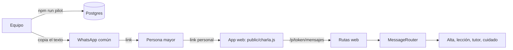

# ADR 0011: piloto por la web, con link personal

**Estado:** propuesto, 12/11/2026. El cambio de rumbo lo decidió el equipo; los detalles los tomé en una sesión autónoma y están en [decisiones-pendientes.md](../decisiones-pendientes.md), de la 53 en adelante.

## Contexto

El piloto ya no va a ser por WhatsApp Business. El trámite de Meta demora, cada mensaje se paga y hace falta un número aprobado. El equipo quiere arrancar ya, con 10 a 30 personas mayores.

Lo que pidió el equipo:

- una app web para celular, pensada para personas mayores;
- entrar con un link personal, sin usuario ni contraseña;
- consentimiento primero, `BAJA` y `AYUDA`, igual que en WhatsApp;
- los recordatorios los manda el equipo a mano por WhatsApp común;
- métricas en CSV;
- que funcione en Chrome de Android y Safari de iPhone, con micrófono.

La Fase 4 (WhatsApp) queda como está, para después. La Fase 5 (programación y recordatorios automáticos) queda en pausa.

## Decisión

### Un canal más, el mismo núcleo

La web es otro adaptador del `MessageRouter`, como WhatsApp y el simulador. El motor de lecciones, el tutor, las capas de seguridad, el alta con consentimiento, `BAJA` y `AYUDA` son los mismos. Solo cambian:

- **el texto del consentimiento** ([`content/consentimiento-web.yaml`](../../content/consentimiento-web.yaml)): no menciona WhatsApp, explica que el link es personal y registra solo `terms_and_privacy`;
- **el contacto:** `web:<id del participante>`, cifrado y con hash como los demás.

### Link personal con token

- `npm run pilot -- crear 10` crea participantes con un código (P01, P02...) y un token al azar de 256 bits. El link es `https://<dominio>/p/<token>`.
- Se guarda el **hash** del token, para buscarlo, y el token **cifrado**, para volver a armar el link de cada recordatorio.
- El sistema **no guarda nombres ni teléfonos**. La relación código-persona vive en la planilla del equipo, fuera del sistema.
- El token no aparece en los logs (se reemplaza por `/p/:token`) ni se pasa a otros sitios (`Referrer-Policy: no-referrer`).
- Si un link se filtra, `npm run pilot -- nuevo-link P07` lo reemplaza y el avance se conserva.
- Con la `BAJA`, se borran los datos y el token; queda solo el código, para no reutilizarlo.

Es el mismo nivel de seguridad que un link de "olvidé mi contraseña": quien tiene el link entra. Alcanza para un piloto sin datos sensibles, y evita lo más difícil para una persona mayor: crear y recordar una contraseña.

### La app

- HTML, CSS y JavaScript simples, sin frameworks (sigue el [ADR 0006](0006-recortes-del-mvp.md)). La política de seguridad del contenido solo deja cargar archivos propios.
- **Para personas mayores:** letra de 22 px (con dos tamaños más), alto contraste, botones de 64 px o más y un botón para hablar de 96 px. Pocas opciones a la vez: en cada paso, los botones que corresponden (Empezar, Acepto, Sí lo hice...).
- **Micrófono:** tocar para empezar y tocar para enviar, más fácil que mantener apretado. Graba en WebM/Opus (Android) o MP4/AAC (iPhone), según lo que acepte el navegador. Máximo 2 minutos.
- **Audio de Charlá:** en MP3, porque el iPhone recién reproduce OGG desde iOS 18.4. El primer toque destraba el reproductor del iPhone, y el servidor entrega el audio por partes (`Range`), como lo exige Safari.
- **PWA:** cada persona tiene su manifiesto, así, al dejarla en la pantalla de inicio, abre su propio link. No hay service worker: no hace falta para instalarla y evita problemas de caché.
- **Historial:** queda en el celular de la persona (`localStorage`), nunca en el servidor.

### Voz en producción

En producción no se usa el reconocimiento de voz del navegador, porque puede mandar el audio a Google o Apple. Sin `OPENAI_API_KEY`, la app funciona solo con texto. Con la clave, el servidor transcribe con `gpt-transcribe`.

### Recordatorios a mano

`npm run pilot -- recordatorios` arma el texto del día para cada persona, con su link, listo para copiar en WhatsApp común. No escribe a quien ya hizo la lección del día, terminó el curso o se dio de baja. Los fines de semana y feriados avisa que no hay lección. Los textos están en [`content/recordatorios-web.yaml`](../../content/recordatorios-web.yaml).

Como los manda una persona del equipo, no se pagan. El tope de 5 mensajes por lección sigue en el motor, porque también limita el costo de IA.

### Métricas

Una tabla nueva, `product_events`, guarda alta, apertura de la app, lección iniciada y completada, pedido de ayuda, mensaje de cuidado y baja. Nunca guarda textos.

El sujeto es el id de la persona, **sin clave foránea**: con la `BAJA`, los datos se borran y los eventos quedan sin poder relacionarse con nadie. Así, la retención cuenta también a quien se fue.

`npm run metrics` calcula los indicadores con una función pura y los exporta a tres CSV sin identificadores:

| Indicador                    | Definición                                                                                         |
| ---------------------------- | -------------------------------------------------------------------------------------------------- |
| Retención a 14 días          | De quienes llevan 14 días o más desde el alta, cuántas iniciaron una lección el día 14 o después   |
| Activas en la segunda semana | Iniciaron una lección entre los días 7 y 13                                                        |
| Activas el día 30            | Igual que la retención, desde el día 30. Dato complementario                                       |
| Completitud                  | Lecciones completadas sobre iniciadas                                                              |
| Autoinicio                   | Lecciones que arrancó la persona. En la web es siempre 100%, porque no hay recordatorio automático |
| Mejor racha media            | Promedio de la mejor racha de cada persona, en días de lección seguidos                            |
| Costo de IA                  | Total y por persona                                                                                |

La satisfacción se mide aparte, con una encuesta del equipo.

## Alternativas

- **Usuario y contraseña:** difícil de recordar para una persona mayor y más soporte para el equipo.
- **Código por SMS o email:** cuesta plata o exige un email que muchas personas no usan.
- **Telegram:** el bot es gratis, pero hay que instalar otra app y aprender otra interfaz.
- **App nativa:** está fuera del MVP, y publicarla demora semanas.

## Consecuencias

- El piloto puede arrancar sin Meta y sin costos de mensajería.
- Cambia la experiencia del estudio: la persona entra a una página en lugar de chatear en WhatsApp. Hay que tenerlo en cuenta al comparar con la propuesta original.
- El equipo hace tarea manual todos los días de lección: copiar y mandar unos 30 mensajes.
- Si el link se reenvía, otra persona puede entrar como esa persona. El consentimiento lo avisa, y el link se puede cambiar.
- El código de WhatsApp sigue en el repositorio, apagado (`WHATSAPP_PROVIDER=disabled`), y se puede retomar después del piloto.
- **Sin probar en celulares reales:** se probó en Chrome con la vista de celular y un micrófono simulado. Hay que probarlo en un Android y un iPhone antes de dar los links (está en la [checklist](../checklist-piloto.md)).
