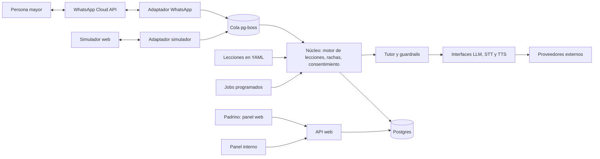

# Arquitectura

Charlá es un **monolito modular**: un solo programa, dividido en módulos con responsabilidades claras. Es más simple de desplegar y de entender que varios servicios, y alcanza de sobra para 30 a 100 usuarios.

Este documento describe el diseño objetivo. Por ahora solo existen el servidor, `/health` y la conexión a Postgres. Cada fase agrega su parte.

## Diagrama

## Ideas principales

- **Los canales son adaptadores.** El núcleo recibe y devuelve mensajes genéricos, sin saber si vienen de WhatsApp o del simulador. Por eso se puede hacer una demo sin depender de Meta, y existe un plan B si Meta cambia sus reglas.
- **El webhook responde enseguida.** Guarda el evento, contesta y deja el trabajo en la cola, porque transcribir audio y generar voz tarda varios segundos.
- **Los proveedores de IA son intercambiables.** El tutor usa interfaces propias, no el SDK de un proveedor directamente.
- **Las lecciones son datos.** Viven en archivos YAML versionados, para que el equipo de contenidos las edite sin programar.

## Cómo arranca una lección

1. El usuario escribe cualquier cosa en un día de lección y eso dispara la lección. Es lo más barato, porque la ventana de 24 horas la abre el usuario.
2. Si no escribió hasta la hora que eligió, sale un único recordatorio. Si la ventana sigue abierta va como mensaje común, y si no, como plantilla.
3. `BAJA` y `AYUDA` son palabras reservadas y tienen prioridad sobre la lección.

Más detalle en el [ADR 0005](adr/0005-whatsapp-inicio-por-usuario-y-curso-cerrado.md).

## Modelo de datos inicial

| Tabla                | Para qué sirve                                                        |
| -------------------- | --------------------------------------------------------------------- |
| `users`              | Teléfono cifrado y un hash para buscarlo, hora elegida, estado        |
| `consents`           | Qué aceptó cada persona, en qué versión y cuándo                      |
| `lesson_attempts`    | Intento de lección: estado, versión del contenido, quién lo inició    |
| `streaks`            | Racha actual y mejor racha, contada sobre lecciones programadas       |
| `inbound_events`     | Eventos recibidos, con ID único de Meta para no procesarlos dos veces |
| `outbound_messages`  | Mensajes enviados, con clave de idempotencia, categoría y costo       |
| `conversation_turns` | Transcripciones, con fecha de vencimiento a los 30 días               |
| `sponsors`           | Padrinos                                                              |
| `sponsor_links`      | Vínculo padrino-mayor, con el consentimiento del mayor                |
| `magic_links`        | Enlaces de acceso de un solo uso para el panel                        |
| `usage_costs`        | Costo por usuario, por día y por proveedor                            |
| `product_events`     | Alta, lección iniciada o completada, abandono, baja                   |
| `survey_responses`   | Encuesta de satisfacción al final de cada nivel                       |

Las lecciones no van en la base: `lesson_attempts` guarda el identificador y la versión del archivo YAML. El diseño se revisa en la Fase 1, y puede cambiar al implementarlo.

## Privacidad

- Los audios se borran apenas se transcriben, y las transcripciones a los 30 días.
- El padrino ve el progreso, nunca el contenido de las conversaciones.
- El CSV para el informe académico sale sin identificadores. Son datos seudonimizados mientras exista la base original, así que no los llamamos anónimos.
- El consentimiento avisa que los datos se procesan fuera de Argentina. Antes del piloto, alguien con formación legal debería revisar el cumplimiento de la Ley 25.326.
